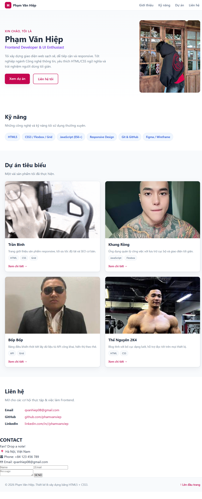
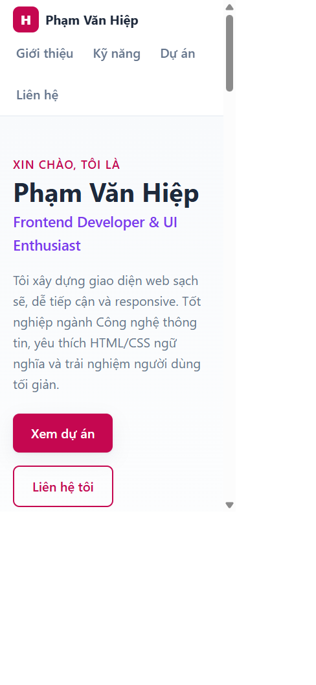

# Báo cáo kiểm thử

**Ngày kiểm thử:** 28/10/2026  
**Phạm vi:** Website portfolio tĩnh (`index.html`, CSS và tài nguyên ảnh).  
**Môi trường:** Trình duyệt Chromium tích hợp; mở trang từ tệp cục bộ; kiểm tra thêm HTTP cục bộ.  
**Kết luận:** Trang hiển thị và tải tài nguyên tốt, nhưng còn lỗi liên kết/định danh và biểu mẫu chưa có chức năng gửi. Chưa đủ cơ sở để xem đây là bản phát hành hoàn chỉnh.

| # | Tiêu chí | Kết quả | Kết quả kiểm thử và minh chứng |
|---|---|---|---|
| 1 | **Tính đúng đắn** | Đạt một phần | Các mục Giới thiệu, Kỹ năng, Dự án, Liên hệ và cả 5 ảnh đều hiển thị/tải thành công; các liên kết điều hướng chính tìm thấy đích. Phát hiện `id="contact"` bị dùng cho hai mục và liên kết email dùng `email:` thay vì `mailto:`, có thể làm điều hướng đến Liên hệ không rõ ràng và email không mở đúng ứng dụng thư. [Ảnh desktop](docs/screenshots/desktop-portfolio.png), [ảnh mobile](docs/screenshots/mobile-portfolio.png). |
| 2 | **UI/UX** | Đạt một phần | Giao diện được hiển thị ở desktop và viewport hẹp; kiểm tra viewport hẹp không thấy tràn ngang và lưới dự án chuyển về một cột. Ảnh, nội dung và điều hướng dễ nhận biết. Hạn chế: các liên kết mạng xã hội/nút xem dự án vẫn là `#`; biểu mẫu thiếu nhãn truy cập được; mục Liên hệ xuất hiện hai lần với nội dung/ngôn ngữ khác nhau. Xem [ảnh desktop](docs/screenshots/desktop-portfolio.png) và [ảnh mobile](docs/screenshots/mobile-portfolio.png). |
| 3 | **Khả năng vận hành - xử lý lỗi** | Đạt một phần | Kiểm tra HTTP cục bộ trả `200` cho trang chính, CSS và ảnh đại diện. Trình duyệt từ chối email sai định dạng và chấp nhận dữ liệu hợp lệ theo ràng buộc HTML. Biểu mẫu chưa kết nối backend, không có xử lý gửi/lưu hoặc thông báo thành công/thất bại; chưa kiểm thử trên hosting thật. |
| 4 | **Bảo mật** | Chưa đánh giá đầy đủ | Phạm vi đang kiểm tra là trang tĩnh; không thấy JavaScript hoặc tích hợp API/backend trong trang. Việc kiểm tra chỉ ở mức đọc mã và kiểm thử trình duyệt, **không** chạy scanner, pentest, kiểm tra header bảo mật, HTTPS hay cấu hình máy chủ. Không xem đây là chứng nhận an toàn bảo mật. |
| 5 | **Chất lượng mã nguồn** | Đạt một phần | Nội dung dùng các phần tử HTML có ngữ nghĩa, ảnh có `alt`, CSS được tách riêng và có breakpoint responsive. Cần xử lý ID trùng, liên kết email sai scheme và các trường biểu mẫu chưa có nhãn; dự án không có bộ kiểm thử tự động/linter được chạy trong lần kiểm tra này. |
| 6 | **Khả năng triển khai** | Đạt có điều kiện | Trang mở được trực tiếp từ tệp cục bộ và smoke test HTTP cục bộ tải thành công trang, CSS, ảnh đại diện; các ảnh còn lại cũng tải được trong trình duyệt. Do là website tĩnh, có thể triển khai trên static hosting hoặc web server; chưa triển khai hay xác minh domain, HTTPS, CDN và môi trường production. |

## Hình ảnh kiểm thử

Ảnh do người kiểm thử tự chụp từ trang đang chạy; ảnh desktop là toàn trang, ảnh mobile là viewport hẹp.

### Desktop

### Mobile

